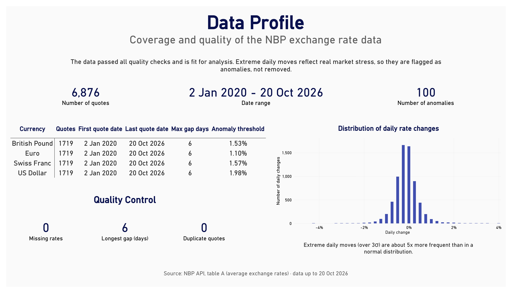
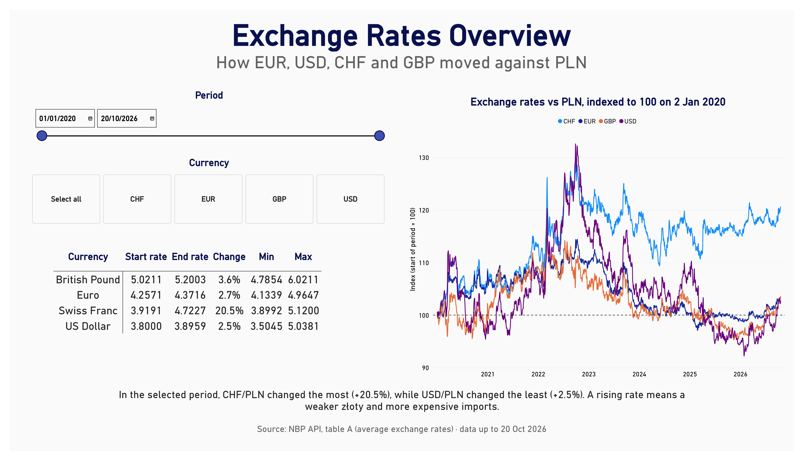
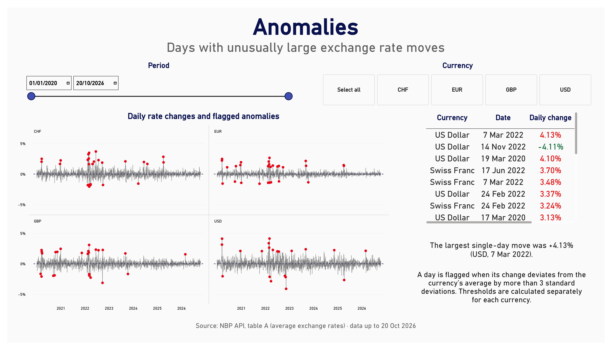

# 💱 PLN Exchange Rate Monitor 

**Analysis of EUR, USD, CHF and GBP exchange rates against the Polish złoty and the currency risk they create for importers**

> Interactive Power BI report built on live data from the National Bank of Poland (NBP) API. It covers daily exchange rates since January 2020, extended automatically with every refresh, and analyses data quality, rate trends, volatility and market anomalies. The report refreshes automatically, and all commentary updates with the data.

---

## 📊 Project Overview

This project analyses daily average exchange rates (NBP table A) for four major currencies against PLN. Data is retrieved directly from the NBP Web API through a custom Power Query function, so a single refresh loads all new quotes without any manual steps. The report is designed around one business question: how exchange rate movements affect the cost of imports.

## 🔍 Scope of Analysis

- Data Profile - coverage, completeness and quality checks, distribution of daily changes
- Overview - rate trends indexed to the start of the selected period
- Volatility & Risk - annualised and 30-day rolling volatility by currency
- Anomalies - days with unusually large rate moves, detected with a consistent statistical rule

## 📈 Key Insights (as of 20 Oct 2026)

- **CHF/PLN** rose the most, by 20.5% since January 2020 (3.92 → 4.72), making CHF-denominated purchases significantly more expensive
- **USD** was the most volatile currency (10.5% annualised), while **EUR** was the most stable (5.8%)
- **100 anomaly days** (1.5% of all daily changes) were flagged, about 5x more often than a normal distribution would suggest
- Anomalies cluster around **March 2020** (COVID-19 market shock) and **February-March 2022** (outbreak of war in Ukraine)
- The **largest single-day move** was +4.13% for USD/PLN on 7 March 2022
- The data passed all quality checks: no missing rates, no duplicate quotes, and the longest gap between quotes (6 days) is explained by public holidays

## ⚙️ Data Pipeline

- **Custom Power Query function** (`fnGetRates`) retrieves rates for any currency and date range from the NBP API
- The NBP API limits a single request to 93 days, so the full period is split into **90-day chunks generated dynamically** up to today's date
- Failed requests are filtered out, so a refresh never adds empty rows
- **Rule-based anomaly detection**: a day is flagged when its change deviates from the currency's average by more than 3 standard deviations, with thresholds calculated separately for each currency
- Anomalies reflect real market stress, so they are **flagged, not removed**
- **Dynamic commentary** written in DAX updates with every refresh and slicer selection

## 🛠️ Tools & Technologies

| Tool | Usage |
|------|-------|
| Power BI Desktop | Visualization and report design |
| Power Query (M) | Web API connection, custom function, dynamic date chunking |
| DAX | Measures (rate index, rolling volatility, anomaly rule), dynamic text and titles |
| NBP Web API | Live source of daily exchange rates (table A) |

## 📁 Repository Structure
```
pln-exchange-rate-monitor/
│
├── README.md
├── PLN_Exchange_Rate_Monitor.pbix     # Power BI report file
├── PLN_Exchange_Rate_Monitor.pdf      # Static report preview
└── screenshots/                       # Report preview images
```

## 📸 Report Preview





---

## 👤 Author

**Marcin Michałowski**  

GitHub: https://github.com/marcin-michalowski

---

*Data source: National Bank of Poland (NBP) Web API, table A - average exchange rates (data as of 20 Oct 2026)*
